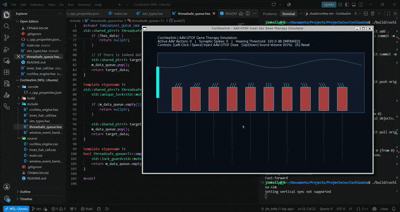

## Multi-threaded SFML 3.0 Simulation of Adeno-Associated Virus OTOF Gene Therapy



This is an attempt at a real-time multi-threaded SFML 3.0 simulation of AAV-OTOF gene therapy, otoferlin synthesis, and synaptic hearing restoration. Inspired by the inner-ear gene therapy breakthrough at Karolinska Institutet.

### A Bit of Background
Some wonderful scientists at [Karolinka Institutet](https://ki.se/en), Sweden, in collaboration with some hospitals and universities in China were able to restore hearing in 10 patients during a clinical trial.

All had a genetic form of deafness caused by mutations in a gene called [OTOF](https://www.genecards.org/card/OTOF). A mutation in said gene leads to a disruption in the production of the protein [otoferlin](https://en.wikipedia.org/wiki/Otoferlin), which is responsible for translating perceived audio waves into auditory signals to be transmitted to the brain for interpretetion.

This project, therefore, is a simple, interractive simulation demonstrating what happens during this gene therapy treatment:

1. An engineered, working version of the OTOF gene is introcuded into the cochlea via an injenction into the rounded window membrane. This gene is contained inside an [Adeno-Associated Virus (AAV)](https://www.addgene.org/guides/aav/). Said virus is normally harmless in nature, and does not lead to the development of diseases in humans. It instead relies on an Aadeno Virus, or Herpes Simplex to replicate. It is used as a delivery system; a vector.
2. Once inside the cochlea, the OTOF gene is absorbed into the inner hair cell. Once inside, the protein [otoferlin](https://en.wikipedia.org/wiki/Otoferlin) is produced which makes it possible to generate auditory signals from the incoming
sound waves.
3. The aforementioned auditory signals are then transmitted via the auditory nerve and into the brain for interpretetion.

> Of course, what I have described above is probably an over-simplification of exactly what happens. My apologies if I haven't gotten the wording and process precisely (bio-technology/medicine is not my background, but I do know a thing or two, and I'm constantly learning.)

Read more about this incredible, groundbreaking research [here](https://news.ki.se/gene-therapy-restored-hearing-in-deaf-patients).

### Requirements
1. [CMake](https://cmake.org/) (Version 4.0 or newer)
2. [C++20](https://cppreference.com/cpp/20) Compiler ([GNU](https://gcc.gnu.org/) | [Clang](https://clang.llvm.org/))

> For the C++ compiler, I warmly recommend you get either GNU or Clang becuase these have support for ThreadSanitizer (TSan) which, can be used to detect data races in this code.

3. [SFML](https://www.sfml-dev.org/)

> For the graphics, this project uses SFML. However, you do not need to explicitly download or build the library by yourself. The first time you run `cmake -B build` as explained below, CMake, using [FetchContent](https://cmake.org/cmake/help/latest/module/FetchContent.html) (please refer to `/CMakeLists.txt` inside the project's base directory) will take care of this for you. `cmake -B build` might take some time the first time, but subsequent builds will be much faster

### Running
1. After making sure you have satisfied the aforementioned requirements, clone this repository.
2. Change directory into its base directory:

    ```base
    $ cd cochlea-sim
    ```
3. Run the following commands to generate the necessary build files:

    ```bash
    $ cmake -B build
    ```
4. Once it successfully completes, from the same base dierectory, run:

    ```bash
    $ cmake --build build
    ```
5. If successful, an executable file will be available inside the newly generated `build` directory: `cochlea-sim.exe` if you're on Windows, `cochlea-sim` if on Unix (Linux/Mac).

> Of course, if you're not happy with the executable name, please feel free to edit the `CMakeLists.txt` file and change all occurences of `cochlea-sim` with your desired name.

6. Run the executable. That's it!

    ```bash
    $ ./build/cochlea-sim
    ```
